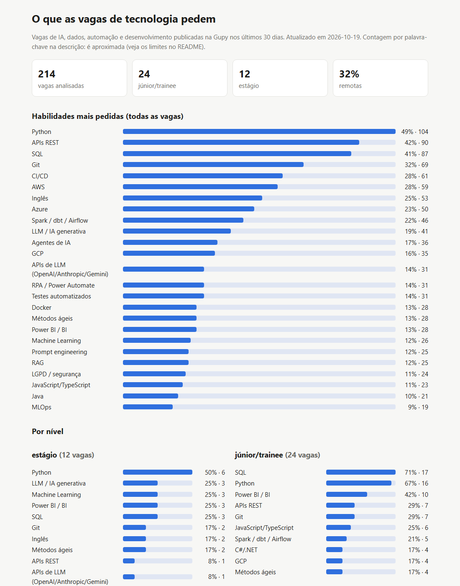

# radar-skills-br

[](https://github.com/arthurpenedo/radar-skills-br/actions/workflows/ci.yml)
[](https://github.com/arthurpenedo/radar-skills-br/actions/workflows/radar.yml)


> **O que as vagas de tecnologia no Brasil pedem de verdade.** Coleta diária das vagas de IA, dados, automação e desenvolvimento publicadas na Gupy, conta as habilidades citadas por nível (estágio, júnior, pleno, sênior) e compara com um perfil para mostrar o que falta estudar.

**Relatório atualizado todo dia:** https://arthurpenedo.github.io/radar-skills-br/



## O problema

Quem procura a primeira vaga em tecnologia ouve de tudo: "aprenda React", "o futuro é IA", "sem nuvem não entra". Cada um fala da própria bolha. Queria responder com dado: **o que as vagas abertas hoje pedem, e o que muda de júnior para sênior?**

## O que faz

1. **Coleta** as vagas dos últimos 30 dias no portal público da Gupy (12 buscas: IA, LLM, IA generativa, automação, dev júnior, Python, dados, ML, RPA, back-end), sem repetir a mesma vaga.
2. **Classifica** o nível pelo título e encontra **36 habilidades** na descrição (Python, SQL, nuvem, Docker, Spark, Power BI, LLM, RAG, agentes, MCP...), com expressões regulares auditáveis em [`skills.py`](src/radar_skills/skills.py).
3. **Gera** um relatório HTML de arquivo único: ranking geral, ranking por nível, onde estão as vagas, quem mais publicou e a lista de vagas filtrável.
4. **Compara um perfil** com o mercado (`radar-skills lacunas`): o que você já mostra e o que mais aparece nas vagas e você ainda não tem.

Roda todo dia às 7h no GitHub Actions e publica no Pages. Sem chave, sem custo, sem dependências além da biblioteca padrão do Python.

## Resultados (coleta de 19/10/2026: 214 vagas)

| Habilidade | Todas as vagas | Vagas júnior/trainee (24) |
|---|---|---|
| Python | 49% | 67% |
| SQL | 41% | **71%** |
| APIs REST | 42% | 29% |
| Git | 32% | 29% |
| AWS / Azure / GCP | 28% / 23% / 16% | 13% / 13% / 17% |
| Spark / dbt / Airflow | 22% | 21% |
| Power BI / BI | 13% | **42%** |
| LLM / IA generativa | 19% | 4% |
| Docker | 13% | 4% |

O que mais me chamou atenção:
- **No júnior, o básico manda.** SQL aparece em 71% das vagas júnior e Python em 67%. LLM aparece em 19% das vagas no geral, mas em só 4% das júnior: IA generativa ainda é pedida mais de quem já tem experiência.
- **Power BI é a surpresa:** 13% no geral, mas 42% das vagas júnior. Muita vaga de entrada em dados começa no painel.
- **Nuvem pesa mais conforme sobe o nível:** AWS em 28% de todas as vagas, contra 13% das júnior.
- **Onde estão:** 47% presenciais, 32% remotas e 21% híbridas; São Paulo tem 47 das 145 vagas com cidade informada.

Exemplo de `lacunas` com o perfil de [`exemplos/perfil.json`](exemplos/perfil.json), contra as vagas júnior:

```
Já cobre:  SQL (71%), Python (67%), APIs REST (29%), Git (29%), RPA / Power Automate (17%), ...
Falta:     Power BI / BI (42%), JavaScript/TypeScript (25%), Spark / dbt / Airflow (21%), C#/.NET (17%), GCP (17%), ...
```

## Como rodar

```bash
pip install -e ".[dev]"
radar-skills coletar --saida vagas.json            # ~2 min, 12 buscas na Gupy
radar-skills coletar --saida vagas.json --remotas  # soma remotas internacionais que aceitam Brasil/LATAM/mundo
radar-skills exportar vagas.json --pasta powerbi   # vagas.csv + vaga_skill.csv (modelo estrela) para o Power BI
radar-skills relatorio vagas.json                  # site/index.html + site/resumo.json
radar-skills lacunas site/resumo.json exemplos/perfil.json --nivel "júnior/trainee"
pytest -q                                          # 20 testes, sem internet
```

Para o seu perfil, copie `exemplos/perfil.json` e liste as habilidades que você consegue **mostrar** (projeto, experiência), usando os nomes do catálogo.

## Limites honestos

- **Gupy por padrão.** Com `--remotas` entram também as remotas internacionais (Remotive, RemoteOK, Himalayas, Jobicy, We Work Remotely, Working Nomads), só as que aceitam Brasil, LATAM ou mundo. Os leitores seguem a documentação pública das APIs e foram testados com respostas gravadas à mão (sem internet): o primeiro uso real pode pedir o ajuste de um campo. LinkedIn, Indeed e sites próprios das empresas ficam de fora (exigem login ou proíbem coleta). A Gupy é forte em empresa grande e média brasileira; startup e vaga internacional aparecem menos.
- **Palavra-chave não é entendimento.** "Inglês" conta mesmo em "inglês não é necessário", e "APIs" conta em "API do Power BI". Os testes cobrem os falsos positivos mais comuns (Java x JavaScript, "rest" dentro de "restante"), mas os números são aproximados.
- **Nível pelo título.** 35% das vagas não dizem o nível no título e ficam como "não informado".
- **Amostra pequena no júnior:** 24 vagas. Diferenças de poucos pontos nesse grupo não querem dizer nada.
- A janela é móvel (30 dias): o relatório mostra o momento, não a tendência. Guardar o histórico é o próximo passo.

## Arquitetura

```
src/radar_skills/
  remotas.py     leitores das APIs remotas internacionais + filtro "aceita Brasil" (download injetável nos testes)
  coleta.py      busca paginada na Gupy, filtro por data, sem repetidas (busca injetável nos testes)
  skills.py      catálogo de 36 habilidades (regex) + nível pelo título
  analise.py     agrega por nível, modelo, cidade e empresa; compara perfil x mercado
  relatorio.py   HTML de arquivo único, modo escuro, filtro de vagas por nível
  cli.py         coletar · relatorio · lacunas
.github/workflows/
  ci.yml         testes em Python 3.11 e 3.13
  radar.yml      coleta diária + publicação no Pages + artefato com o JSON (90 dias)
```

---
Feito por [Arthur Penedo](https://www.linkedin.com/in/arthurpenedo). Dados públicos do portal da Gupy.
